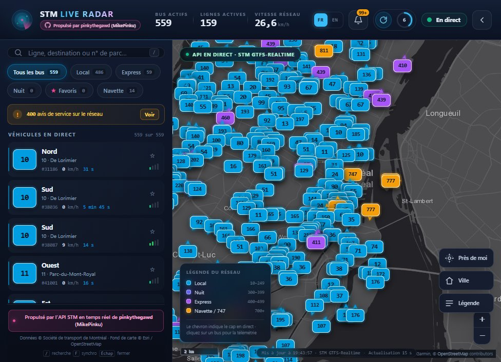

<div align="center">
  <a href="https://stm-live-radar.vercel.app">
    
  </a>

  <p><strong>🚌 Radar en temps réel des bus STM de Montréal — bilingue, français par défaut, en ligne sur Vercel.</strong></p>

  <p>
    <a href="https://stm-live-radar.vercel.app"></a>
    <a href="https://github.com/pinkythegawd/stm-live-radar"></a>
    <a href="https://github.com/pinkythegawd/stm-live-radar/blob/main/LICENSE"></a>
  </p>

  <p>
    
    
    
    
  </p>

  <p>
    <a href="README.fr.md">🇫🇷 Français</a> · <a href="README.md">🇬🇧 English</a>
  </p>
</div>

---

Un centre de commande sombre et temps réel pour le réseau de bus STM de
Montréal. Les positions des bus s'affichent sur une carte Leaflet toutes les
15 secondes, avec pastilles de ligne orientées selon le cap, infobulles de
télémétrie, avis de service, favoris, mise en évidence « Près de moi » et un
panneau mobile adaptatif. L'interface est **bilingue — français par défaut —
avec un sélecteur FR/EN persistant**.

**🔗 Application en direct :** <https://stm-live-radar.vercel.app>  
**📦 Code source :** <https://github.com/pinkythegawd/stm-live-radar>  
**💜 Propulsé par l'API STM en temps réel de [pinkythegawd (MikePinku)](https://github.com/pinkythegawd).**

---

## 📸 Aperçu en direct

<div align="center">
  
  <sub>Tableau de bord en production — bus en direct, filtres de lignes, télémétrie et interface française.</sub>
</div>

---

## ✨ Points forts

- **🚌 Carte en direct** — tous les véhicules STM actifs, colorés selon le type
  de réseau : Local (10–249), Nuit (300s), Express (400s, violet), Navette/747 (700+).
- **⚡ Actualisation toutes les 15 secondes** sans réinitialiser la vue ni le zoom.
- **⏱️ Anneau de compte à rebours + synchronisation forcée** avec un cache
  serveur de 8 secondes.
- **🛰️ Glissement fluide des marqueurs** entre deux positions GPS. Les marqueurs
  et les infobulles ouvertes restent en place lors des rafraîchissements.
- **📊 Infobulle de télémétrie** — vitesse, cap, âge du GPS, jauge d'occupation
  et verrouillage/suivi caméra ou épinglage de ligne en un clic.
- **🔎 Recherche** par ligne, destination ou numéro de véhicule ; filtres
  Tout / Local / Express / Nuit / Favoris / Navette.
- **⭐ Lignes favorites** enregistrées dans `localStorage`, avec le nombre de
  véhicules par ligne.
- **📍 Près de moi** — met en évidence les bus à moins de 2 km et dessine le
  rayon sur la carte.
- **🔔 Tiroir des avis de service** — messages d'état du service STM, filtrables
  selon les lignes visibles sur la carte.
- **🧪 Simulation de secours automatique** dans Montréal si le flux en direct
  est inaccessible, clairement identifiée `SIMULATION` pour ne jamais la
  confondre avec des données réelles.
- **🌍 Interface bilingue, français d'abord** — chaque libellé, infobulle,
  notification, état vide et le tiroir des avis basculent instantanément entre
  le français et l'anglais ; le choix est mémorisé sur l'appareil. Les dates,
  nombres et temps relatifs suivent la locale sélectionnée.
- **📦 Aucune étape de build, aucune dépendance d'exécution.** Un petit serveur
  HTTP Node, des modules ES natifs et Leaflet 1.9.4 hébergé localement.
- **🛰️ Fond de carte sombre sans clé** — Esri World Dark Gray Canvas avec libellés.
- **☁️ Prêt pour Vercel** — frontend statique et quatre fonctions API serverless.

---

## 🚀 Démarrage rapide

### ⏱️ Installation locale en deux minutes

**Prérequis :** [Node.js 18.17+](https://nodejs.org/), une
[clé STM Open Data](https://portail.developpementdurable.stm.info/) gratuite et
un terminal. Aucune base de données, aucune étape de build et aucun
`npm install` ne sont nécessaires.

```bash
# 1. Clonez le dépôt
git clone https://github.com/pinkythegawd/stm-live-radar.git
cd stm-live-radar

# 2. Configurez votre clé STM (le dépôt fournit .env.example)
cp .env.example .env        # Windows : copy .env.example .env
# puis modifiez .env et renseignez STM_API_KEY=...

# 3. Lancez l'application
npm start                   # ou : node server/index.js
```

Ouvrez <http://localhost:4173>. La première image en direct arrive généralement
en quelques secondes. Sans clé configurée, l'application démarre quand même en
mode `SIMULATION` clairement identifié pour explorer l'interface.

> **🪟 Note Windows PowerShell :** si l'exécution des scripts est désactivée,
> utilisez `npm.cmd start` ou lancez directement `node server/index.js`.

### 🧪 Tests

```bash
npm test          # ou : node --test
```

La suite couvre les nouvelles tentatives transitoires, la gestion des erreurs
permanentes et le comportement de `Retry-After`, sans accès réseau.

### 🔑 Variables d'environnement

| Variable | Valeur par défaut | Rôle |
| --- | --- | --- |
| `STM_API_KEY` | — | Clé STM Open Data. Requise pour les données en direct. |
| `PORT` | `4173` | Port HTTP. |
| `HOST` | `0.0.0.0` | Adresse d'écoute. |
| `STM_TIMEOUT_MS` | `12000` | Délai d'expiration par tentative vers STM. |
| `STM_RETRY_ATTEMPTS` | `2` | Nombre total de tentatives pour les erreurs transitoires (limité à 1–3). |
| `STM_RETRY_BASE_MS` | `400` | Délai de base de l'attente exponentielle. |
| `STM_RETRY_MAX_MS` | `1500` | Délai maximal entre les tentatives ; un `Retry-After` plus long renvoie immédiatement la réponse pour servir les données en cache. |
| `VEHICLES_CACHE_MS` | `8000` | Durée du cache des véhicules, partagé entre les clients. |
| `ALERTS_CACHE_MS` | `60000` | Durée du cache des avis de service. |
| `LOG_REQUESTS` | `true` | Journalisation des requêtes. |
| `CUSTOM_API_BASE_URL` | — | API JSON pinkythegawd optionnelle ; essayée en premier. |
| `CUSTOM_API_VEHICLES_PATH` | `/vehicles` | Point de terminaison des véhicules personnalisé. |
| `CUSTOM_API_ALERTS_PATH` | `/alerts` | Point de terminaison des avis personnalisé. |
| `CUSTOM_API_ROUTES_PATH` | `/routes` | Point de terminaison des lignes personnalisé. |
| `CUSTOM_API_KEY` | — | Clé optionnelle pour l'API personnalisée. |
| `CUSTOM_API_KEY_HEADER` | `x-api-key` | Nom de l'en-tête pour cette clé. |
| `CUSTOM_API_KEY_PREFIX` | — | Par exemple `Bearer`. |
| `CUSTOM_API_TIMEOUT_MS` | `10000` | Délai d'expiration de l'API personnalisée. |

`.env` est ignoré par Git. La clé STM n'est **jamais** envoyée au navigateur —
tous les appels aux sources se font dans le proxy Node.

---

## ☁️ Déploiement sur Vercel

L'application fonctionne sur Vercel comme un site statique accompagné de quatre
fonctions serverless. Le frontend est servi depuis `public/`, et
`api/health.js`, `api/vehicles.js`, `api/alerts.js` et `api/routes.js`
réutilisent le même gestionnaire HTTP que le serveur local. Aucune étape de
build n'est nécessaire.

1. Poussez ce dépôt sur GitHub.
2. Dans le [tableau de bord Vercel](https://vercel.com/new), importez le dépôt.
   Laissez le framework sur **Other** ; `vercel.json` définit déjà le dossier de
   sortie sur `public`.
3. Ajoutez `STM_API_KEY` dans **Settings → Environment Variables** pour la
   production (et la prévisualisation si souhaité). N'ajoutez pas de fichier
   `.env`.
4. Déployez.

Ou utilisez la CLI depuis la racine du dépôt :

```bash
npx vercel link
npx vercel env add STM_API_KEY production
npx vercel env add STM_API_KEY preview
npx vercel --prod
```

Le cache serverless est propre à chaque instance active : une instance peut donc
faire un appel avant de partager son instantané de 8 secondes. L'interrogation
toutes les 15 secondes et la limite de synchronisation forcée de 2,5 secondes
protègent toujours l'API en amont.

> **🌐 URL de production :** <https://stm-live-radar.vercel.app>

---

## 🔌 Configuration de l'API

### 🛰️ Proxy serveur (recommandé)

`server/config.js` lit les variables d'environnement ci-dessus. Points de
terminaison exposés à l'interface :

| Point de terminaison | Description |
| --- | --- |
| `GET /api/vehicles` | Véhicules en direct normalisés + statistiques du réseau. Ajoutez `?force=1` pour contourner le cache (limité à un appel amont toutes les 2,5 s). |
| `GET /api/alerts` | Avis de service STM dédupliqués. Les avis officiels incluent `titleFr`/`titleEn` et `descriptionFr`/`descriptionEn` pour que l'interface change de langue sans nouvelle requête. |
| `GET /api/routes` | Catalogue des lignes et métadonnées de destination depuis `server/data/route-meta.json`. |
| `GET /api/health` | Configuration des sources, disponibilité, version des métadonnées de lignes. |

### 🔗 API JSON directe / personnalisée

La configuration du transport côté navigateur se trouve en haut de
`public/js/services/stmApiService.js` :

```js
export const STM_API_CONFIG = {
  baseUrl: '',                 // même origine ; mettez une URL absolue en cas d'hébergement séparé
  endpoints: { vehicles: '/api/vehicles', alerts: '/api/alerts', routes: '/api/routes' },
  pollIntervalMs: 15000,
  customApi: {
    enabled: false,
    baseUrl: '',               // ex. 'https://stm-api.example.com'
    vehiclesPath: '/vehicles',
    apiKey: '',
    apiKeyHeader: 'x-api-key',
  },
};
```

Activez `customApi` pour appeler une API JSON directement depuis le navigateur
(cette API doit autoriser le CORS). Le normaliseur accepte les tableaux plats
ainsi que le JSON GTFS-Realtime imbriqué, et détecte automatiquement l'unité de
vitesse.

### 🥇 Priorité des sources

1. **API JSON pinkythegawd** lorsque `CUSTOM_API_BASE_URL` est défini.
2. **GTFS-Realtime officiel STM** (protobuf décodé côté serveur).
3. **Simulation côté client** dans l'Ouest-de-l'Île, le centre-ville, LaSalle,
   Lachine, Côte-Vertu et Pie-IX, identifiée `SIMULATION` avec un compte à
   rebours en direct.

### 🛡️ Résilience et dégradation gracieuse

- **Tentatives bornées** — les erreurs réseau, les délais d'expiration et les
  réponses transitoires `408/425/429/5xx` sont réessayés avec une attente
  exponentielle (`STM_RETRY_ATTEMPTS`, `STM_RETRY_BASE_MS`,
  `STM_RETRY_MAX_MS`). Les `4xx` permanents ne sont jamais réessayés.
- **Respect de `Retry-After`** — si STM demande une attente supérieure à
  `STM_RETRY_MAX_MS`, le serveur arrête les tentatives et répond immédiatement
  au lieu de bloquer la requête.
- **Cache de secours** — si un rafraîchissement échoue après un bon instantané,
  `/api/vehicles` renvoie cet instantané avec `mode: "stale"` au lieu d'une
  carte vide.
- **Simulation de secours** — sans instantané utilisable, le client bascule sur
  la simulation locale de Montréal et réessaie l'API en direct toutes les
  15 secondes.
- **Les avis ne cassent jamais la carte** — une erreur sur les avis renvoie une
  liste vide ; le tableau de bord reste pleinement utilisable.
- **État visible** — la barre de commande expose les états `LIVE`, `STALE` et
  `SIMULATION`, et les transitions déclenchent des notifications localisées.

---

## 🗺️ Métadonnées des lignes

Le flux temps réel contient `route_id` et `direction_id`, mais pas la
destination. Le tableau de bord enrichit donc chaque véhicule à partir de
`server/data/route-meta.json`, généré depuis l'archive GTFS statique publique de
la STM :

```bash
npm run routes:build
# ou : node server/tools/build-route-meta.js [chemin-vers-gtfs_stm.zip]
```

Le script télécharge `gtfs_stm.zip`, parcourt `trips.txt` et écrit la destination
la plus fréquente pour chaque paire ligne/direction. Relancez-le lorsque la STM
publie un nouvel horaire. Le JSON généré est versionné pour que l'application
fonctionne immédiatement.

Pour inspecter le flux temps réel brut pendant le débogage :

```bash
npm run feed:inspect
```

---

## 🧱 Architecture

```
api/                    Points d'entrée serverless Vercel (vehicles, alerts, routes, health)
server/
  index.js              Serveur HTTP, routes proxy, cache, fichiers statiques, CSP
  vercel.js             Réexporte le gestionnaire pour les fonctions Vercel
  config.js             Configuration et limites d'environnement
  lib/
    protobuf.js         Décodeur minimal du format binaire protobuf
    gtfsRt.js           Décodeur GTFS-Realtime FeedMessage
    normalizer.js       Forme canonique des véhicules, catégories, caps
    http.js, cache.js   Réponses JSON et cache TTL
    upstream.js         Récupération amont avec nouvelles tentatives et Retry-After
    routeMeta.js        Chargeur des métadonnées de lignes
  sources/
    stmOfficial.js      Adaptateurs GTFS-RT et état du service STM
    customApi.js        Adaptateur de l'API JSON pinkythegawd
    alerts.js           Pipeline de récupération et déduplication des avis
  tools/
    build-route-meta.js GTFS statique → route-meta.json
    inspect-feed.js     Diagnostic du flux brut
  data/route-meta.json  210 lignes, destinations françaises authentiques

public/
  index.html            Coquille de l'app : en-tête, panneau, calques, tiroir d'avis
  css/app.css           Design system, carte/marqueurs, mise en page responsive
  js/
    config.js           Présentation, carte, interrogation, clés de stockage
    i18n.js             Dictionnaires FR/EN, pluriels, aides de locale
    main.js             Amorçage, actions, interrogation, près de moi, raccourcis
    core/store.js       État observable + sélecteurs
    core/poller.js      Moteur d'interrogation de 15 s avec compte à rebours
    map/mapController.js Marqueurs, interpolation, infobulles, suivi, géolocalisation
    services/           Transport API, normalisation, simulation
    ui/                 Barre de commande, panneau, avis, gabarits, notifications
    utils/              Formatage, géo, stockage
  vendor/leaflet/       Leaflet 1.9.4 (local, sans CDN)
  assets/favicon.svg
  manifest.webmanifest

docs/
  readme-banner.svg     En-tête personnalisé du README
  screenshot.jpg        Capture de la production

test/
  upstream.test.js      Tests des tentatives, délais et Retry-After
```

### 🌍 Langues

Le français est la langue par défaut et est rendu directement dans `index.html`,
donc le premier affichage est déjà localisé. Le contrôle `FR` / `EN` de la barre
de commande appelle `setLang()` dans `public/js/i18n.js` ; le choix est stocké
sous `stm-live-radar:lang:v1`. Les modules dynamiques se réaffichent lors du
changement de langue, notamment les fiches de véhicules, les infobulles de la
carte, les info-bulles des marqueurs, les avis, les notifications et le titre du
document. Le formatage `fr-CA` / `en-CA` est utilisé pour les nombres, les dates
et l'âge relatif du GPS. En cas d'échec du flux en direct, les avis simulés sont
régénérés dans la langue sélectionnée.

Pour ajouter une autre langue, ajoutez un bloc de dictionnaire dans
`public/js/i18n.js`, étendez les boutons `data-lang` dans `index.html` et ajoutez
la locale à l'ensemble `SUPPORTED`.

### 🎨 Design system

- Base : `#0f172a` / surface `#1e293b`, cyan STM `#009ee0`
- Express violet `#a855f7` (réseau haute fréquence), nuit indigo, navette or,
  brand rose `#ec4899`
- Typographie : display condensé pour la marque, monospace pour la télémétrie
- Bureau : panneau fixe de 404 px + carte plein écran ; se replie en panneau
  inférieur ≤ 900 px
- Clavier : `/` recherche, `F` synchronisation forcée, `Esc` ferme les tiroirs
  et panneaux

### 📍 Carte

Leaflet avec le fond **Esri World Dark Gray Canvas** et les couches de libellés
de référence. Les deux sont sans clé. Les tuiles sont attribuées à Esri, HERE,
Garmin et aux contributeurs OpenStreetMap dans la carte et le panneau. Le
mouvement des marqueurs utilise une transition CSS pour la flotte et une
interpolation JS pour le bus sélectionné ou suivi, afin que son infobulle reste
parfaitement alignée.

---

## 🔐 Confidentialité et sécurité

- Aucun outil d'analyse, cookie ou script tiers.
- La clé STM reste côté serveur ; le navigateur ne communique qu'avec `/api/*`
  sur la même origine.
- CSP stricte (`script-src 'self'`, aucun script en ligne), `X-Frame-Options`,
  `nosniff` et `Permissions-Policy` restrictive (géolocalisation uniquement pour
  « Près de moi »).
- La géolocalisation n'est demandée qu'en cliquant sur **Près de moi** ; les
  coordonnées ne quittent jamais le navigateur.
- Les favoris, l'état du panneau et le choix de langue sont stockés localement
  dans `localStorage`.

---

## 🧯 Dépannage

| Symptôme | Solution |
| --- | --- |
| Pastille `SIMULATION` | Vérifiez `STM_API_KEY` et l'accès réseau à `api.stm.info` ; consultez `/api/health`. |
| `502 UPSTREAM_UNAVAILABLE` | Hoquet du flux STM ou clé invalide ; l'interface devrait basculer automatiquement. |
| Tuiles de carte vides | Vérifiez l'accès à `server.arcgisonline.com` ; le zoom reste utilisable sans tuiles. |
| `npm` bloqué sous Windows | Utilisez `npm.cmd start` ou `node server/index.js`. |
| Destinations erronées ou vides | Régénérez les métadonnées : `npm run routes:build`. |
| Pas de données sur Vercel | Ajoutez `STM_API_KEY` aux variables d'environnement du projet et redéployez. |

---

## 💜 Crédits

- Données temps réel : **STM Open Data** — positions des véhicules GTFS-Realtime
  et avis d'état du service.
- Crédit API : **pinkythegawd (MikePinku)** —
  <https://github.com/pinkythegawd>.
- Fond de carte : **Esri** World Dark Gray Canvas, avec les contributeurs
  OpenStreetMap.
- Cartographie : **Leaflet** 1.9.4 (BSD-2-Clause), hébergé dans
  `public/vendor/leaflet`.

---

## 📄 Licence

MIT. Les données STM restent soumises aux conditions d'utilisation de STM Open
Data.

<div align="center">
  <sub>🚌 Fait avec de la caféine, des données de transport et un peu d'entêtement montréalais. · <a href="README.md">English version</a></sub>
</div>
