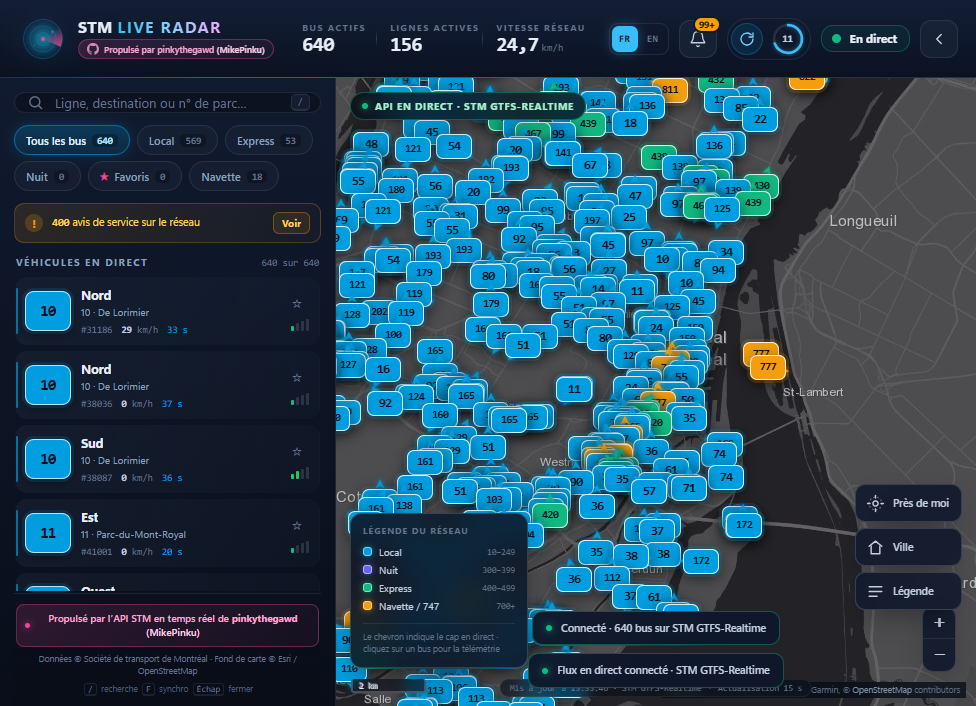

<div align="center">
  <a href="https://stm-live-radar.vercel.app">
    
  </a>

  <p><strong>🚌 Real-time STM bus radar for Montréal — bilingual, French-first, live on Vercel.</strong></p>

  <p>
    <a href="https://stm-live-radar.vercel.app"></a>
    <a href="https://github.com/pinkythegawd/stm-live-radar"></a>
    <a href="https://github.com/pinkythegawd/stm-live-radar/blob/main/LICENSE"></a>
  </p>

  <p>
    
    
    
    
  </p>

  <p>
    <a href="README.fr.md">🇫🇷 Lire en français</a> · <a href="README.md">🇬🇧 English</a>
  </p>
</div>

---

A real-time, dark-mode command center for Montréal's STM bus network. Live bus
positions stream onto a Leaflet map every 15 seconds with heading-aware route
pills, telemetry popups, service alerts, favorites, near-me highlighting and a
responsive mobile bottom sheet. The interface is **bilingual — French by
default — with a persistent EN/FR switch**.

**🔗 Live app:** <https://stm-live-radar.vercel.app>  
**📦 Source:** <https://github.com/pinkythegawd/stm-live-radar>  
**💜 Powered by the STM Real-Time API by [pinkythegawd (MikePinku)](https://github.com/pinkythegawd).**

---

## 📸 Live at a glance

<div align="center">
  
  <sub>Production dashboard — live buses, route filters, telemetry and the French-first interface.</sub>
</div>

---

## ✨ Highlights

- **🚌 Live map** — every active STM vehicle, colored by network type:
  Local (10–249), Night (300s), Express (400s, purple), Shuttle/747 (700+).
- **⚡ 15-second polling** that never resets your viewport or zoom.
- **⏱️ Countdown ring + Force Sync** with an 8-second server-side cache.
- **🛰️ Smooth marker glide** between GPS frames. Markers and open popups persist
  across refreshes — nothing is torn down and re-created.
- **📊 Telemetry popup** — speed, compass heading, GPS age, occupancy meter and
  one-click camera lock/follow or route pinning.
- **🔎 Search** by route, destination, or fleet number; filter chips for
  All / Local / Express / Night / Pinned / Shuttle.
- **⭐ Pinned routes** stored in `localStorage`, with per-route vehicle counts.
- **📍 Near Me** — highlights every bus inside 2 km and draws the radius on the map.
- **🔔 Service alerts drawer** — STM état du service notices, filterable to routes
  currently visible on the map.
- **🧪 Automatic fallback simulation** across Montréal if the live feed is
  unreachable, clearly labeled `SIMULATION` so it is never mistaken for live data.
- **🌍 French-first bilingual interface** — every label, popup, toast, empty state
  and the service-alerts drawer switch instantly between French and English; the
  choice is saved on the device. Dates, numbers and relative times follow the
  selected locale.
- **📦 Zero build step, zero runtime dependencies.** A small Node HTTP server plus
  native ES modules and locally vendored Leaflet 1.9.4.
- **🛰️ Keyless dark basemap** — Esri World Dark Gray Canvas with labels.
- **☁️ Vercel-ready** — static frontend plus four serverless API functions.

---

## 🚀 Quick start

### ⏱️ Two-minute local setup

**You need:** [Node.js 18.17+](https://nodejs.org/), a free
[STM Open Data key](https://portail.developpementdurable.stm.info/), and a
terminal. No database, no build step and no `npm install` are required.

```bash
# 1. Clone the repository
git clone https://github.com/pinkythegawd/stm-live-radar.git
cd stm-live-radar

# 2. Configure your STM key (the repo ships with .env.example)
cp .env.example .env        # Windows: copy .env.example .env
# then edit .env and set STM_API_KEY=...

# 3. Run
npm start                   # or: node server/index.js
```

Open <http://localhost:4173>. The first live frame usually arrives within a
couple of seconds. If no key is configured, the app still starts in a clearly
labeled `SIMULATION` mode so you can explore the interface.

> **🪟 Windows PowerShell note:** if script execution is disabled, use
> `npm.cmd start` or run `node server/index.js` directly.

### 🧪 Tests

```bash
npm test          # or: node --test
```

The test suite covers transient retries, permanent-error handling and
`Retry-After` behavior without network access.

### 🔑 Environment variables

| Variable | Default | Purpose |
| --- | --- | --- |
| `STM_API_KEY` | — | STM Open Data key. Required for live data. |
| `PORT` | `4173` | HTTP port. |
| `HOST` | `0.0.0.0` | Bind address. |
| `STM_TIMEOUT_MS` | `12000` | Upstream STM request timeout per attempt. |
| `STM_RETRY_ATTEMPTS` | `2` | Total attempts for transient upstream failures (clamped to 1–3). |
| `STM_RETRY_BASE_MS` | `400` | Exponential-backoff base delay. |
| `STM_RETRY_MAX_MS` | `1500` | Maximum retry delay; longer `Retry-After` waits return immediately so stale data can be served. |
| `VEHICLES_CACHE_MS` | `8000` | Vehicle cache TTL shared by all clients. |
| `ALERTS_CACHE_MS` | `60000` | Service-alert cache TTL. |
| `LOG_REQUESTS` | `true` | Request logging. |
| `CUSTOM_API_BASE_URL` | — | Optional pinkythegawd JSON API; tried first. |
| `CUSTOM_API_VEHICLES_PATH` | `/vehicles` | Custom vehicles endpoint. |
| `CUSTOM_API_ALERTS_PATH` | `/alerts` | Custom alerts endpoint. |
| `CUSTOM_API_ROUTES_PATH` | `/routes` | Custom routes endpoint. |
| `CUSTOM_API_KEY` | — | Optional key for the custom API. |
| `CUSTOM_API_KEY_HEADER` | `x-api-key` | Header name for that key. |
| `CUSTOM_API_KEY_PREFIX` | — | e.g. `Bearer`. |
| `CUSTOM_API_TIMEOUT_MS` | `10000` | Custom API request timeout. |

`.env` is git-ignored. The STM key is **never** sent to the browser — all
upstream calls happen in the Node proxy.

---

## ☁️ Deploy to Vercel

The app runs on Vercel as a static site plus four serverless functions. The
frontend is served from `public/`, and `api/health.js`, `api/vehicles.js`,
`api/alerts.js` and `api/routes.js` reuse the same HTTP handler as the local
server. No build step is required.

1. Push this repository to GitHub.
2. In the [Vercel dashboard](https://vercel.com/new), import the repository.
   Leave the framework as **Other**; `vercel.json` already sets the output
   directory to `public`.
3. Add `STM_API_KEY` under **Settings → Environment Variables** for Production
   (and Preview if desired). Do not add a `.env` file.
4. Deploy.

Or use the CLI from the repository root:

```bash
npx vercel link
npx vercel env add STM_API_KEY production
npx vercel env add STM_API_KEY preview
npx vercel --prod
```

The serverless cache is per warm function instance, so each instance may fetch
once before sharing its 8-second snapshot. The client's 15-second polling and
the 2.5-second force-sync throttle still protect the upstream API.

> **🌐 Production URL:** <https://stm-live-radar.vercel.app>

---

## 🔌 API configuration

### 🛰️ Server proxy (recommended)

`server/config.js` reads the environment above. Endpoints exposed to the UI:

| Endpoint | Description |
| --- | --- |
| `GET /api/vehicles` | Normalized live vehicles + network stats. Add `?force=1` to bypass the cache (rate-limited to one upstream call every 2.5 s). |
| `GET /api/alerts` | Deduplicated STM service notices. Official notices include `titleFr`/`titleEn` and `descriptionFr`/`descriptionEn` so the UI can switch language without refetching. |
| `GET /api/routes` | Route catalogue/headsign metadata from `server/data/route-meta.json`. |
| `GET /api/health` | Source configuration, uptime, route metadata version. |

### 🔗 Direct / custom JSON API

The browser-side transport configuration lives at the top of
`public/js/services/stmApiService.js`:

```js
export const STM_API_CONFIG = {
  baseUrl: '',                 // same origin; set an absolute URL if split-hosting
  endpoints: { vehicles: '/api/vehicles', alerts: '/api/alerts', routes: '/api/routes' },
  pollIntervalMs: 15000,
  customApi: {
    enabled: false,
    baseUrl: '',               // e.g. 'https://stm-api.example.com'
    vehiclesPath: '/vehicles',
    apiKey: '',
    apiKeyHeader: 'x-api-key',
  },
};
```

Enable `customApi` to call a JSON API directly from the browser (that API must
allow CORS). The normalizer accepts flat arrays as well as nested
GTFS-Realtime JSON and auto-detects speed units.

### 🥇 Source priority

1. **pinkythegawd JSON API** when `CUSTOM_API_BASE_URL` is set.
2. **Official STM GTFS-Realtime** protobuf feed (decoded server-side).
3. **Client simulation** across West Island, Downtown, LaSalle, Lachine,
   Côte-Vertu and Pie-IX, labeled `SIMULATION` with a live countdown.

### 🛡️ Resilience & graceful degradation

- **Bounded retries** — network errors, timeouts and transient `408/425/429/5xx`
  responses are retried with exponential backoff (`STM_RETRY_ATTEMPTS`,
  `STM_RETRY_BASE_MS`, `STM_RETRY_MAX_MS`). Permanent `4xx` responses are not
  retried.
- **`Retry-After` aware** — if STM asks for a wait longer than
  `STM_RETRY_MAX_MS`, the server stops retrying and returns immediately instead
  of blocking the request.
- **Stale-if-error** — if an upstream refresh fails after a previous good
  snapshot, `/api/vehicles` serves that snapshot as `mode: "stale"` instead of
  returning an empty map.
- **Simulation fallback** — with no usable snapshot, the client switches to the
  local Montréal simulation and keeps retrying the live API every 15 seconds.
- **Alerts never break the map** — alert failures return an empty list; the
  dashboard remains fully usable.
- **Visible status** — the command bar exposes `LIVE`, `STALE` and `SIMULATION`
  states, and transitions produce localized toasts.

---

## 🗺️ Route metadata

The realtime feed carries `route_id` and `direction_id` but no headsign. The
dashboard therefore enriches each vehicle from `server/data/route-meta.json`,
which is generated from STM's public GTFS static archive:

```bash
npm run routes:build
# or: node server/tools/build-route-meta.js [path-to-gtfs_stm.zip]
```

The script downloads `gtfs_stm.zip`, scans `trips.txt` and writes the most
common headsign for every route/direction pair. Re-run it when STM publishes a
new schedule. The generated JSON is committed so the app works out of the box.

To inspect the raw realtime feed while debugging:

```bash
npm run feed:inspect
```

---

## 🧱 Architecture

```
api/                    Vercel serverless entry points (vehicles, alerts, routes, health)
server/
  index.js              HTTP server, proxy routes, caching, static files, CSP
  vercel.js             Re-exports the handler for Vercel functions
  config.js             Environment configuration and limits
  lib/
    protobuf.js         Minimal protobuf wire-format decoder
    gtfsRt.js           GTFS-Realtime FeedMessage decoder
    normalizer.js       Canonical vehicle shape, categories, bearings
    http.js, cache.js   JSON responses and TTL cache
    upstream.js         Retrying upstream fetch with Retry-After support
    routeMeta.js        Route metadata loader
  sources/
    stmOfficial.js      Official STM GTFS-RT + service status adapters
    customApi.js        pinkythegawd JSON API adapter
    alerts.js           Alert fetch/dedupe pipeline
  tools/
    build-route-meta.js GTFS static → route-meta.json
    inspect-feed.js     Raw feed diagnostics
  data/route-meta.json  210 routes, authentic French headsigns

public/
  index.html            App shell: header, sidebar, map overlays, alerts drawer
  css/app.css           Design system, map/marker styling, responsive layout
  js/
    config.js           Presentation, map, polling, storage keys
    i18n.js             FR/EN dictionaries, pluralisation, locale helpers
    main.js             Bootstrap, actions, polling, near-me, shortcuts
    core/store.js       Observable state + selectors
    core/poller.js      15 s polling engine with countdown
    map/mapController.js Markers, interpolation, popups, follow, geolocation
    services/           API transport, normalization, simulation
    ui/                 Command bar, sidebar, alerts, templates, toasts
    utils/              Formatting, geo, storage
  vendor/leaflet/       Leaflet 1.9.4 (local, no CDN)
  assets/favicon.svg
  manifest.webmanifest

docs/
  readme-banner.svg     Custom README header
  screenshot.png        Live production screenshot

test/
  upstream.test.js      Retry, timeout and Retry-After tests
```

### 🌍 Languages

French is the default and is rendered directly in `index.html`, so the first
paint is already localized. The `FR` / `EN` control in the command bar calls
`setLang()` in `public/js/i18n.js`; the choice is stored under
`stm-live-radar:lang:v1`. Dynamic modules re-render on the language-change
event, including vehicle cards, map popups, marker tooltips, alerts, toasts and
the document title. `fr-CA` / `en-CA` locale formatting is used for numbers,
dates and relative GPS ages. When the live feed fails, simulated service
advisories are regenerated in the selected language.

To add another language, add a dictionary block in `public/js/i18n.js`, extend
the `data-lang` buttons in `index.html`, and add the locale to the `SUPPORTED`
set.

### 🎨 Design system

- Base: `#0f172a` / surface `#1e293b`, STM cyan `#009ee0`
- Express purple `#a855f7` (high-frequency network), night indigo, shuttle gold,
  branding pink `#ec4899`
- Typography: condensed display for branding, monospace for telemetry
- Desktop: fixed 404 px sidebar + full map; collapses to a bottom sheet ≤ 900 px
- Keyboard: `/` search, `F` force sync, `Esc` close drawers/sheets

### 📍 Map

Leaflet with **Esri World Dark Gray Canvas** base and reference-label layers.
Both are keyless. Tiles are attributed to Esri, HERE, Garmin and
OpenStreetMap contributors in the map and sidebar. Marker motion uses a CSS
transform transition for the fleet and JS interpolation for the selected or
followed bus so its open popup tracks perfectly.

---

## 🔐 Privacy & security

- No analytics, cookies or third-party scripts.
- The STM key stays server-side; the browser only talks to same-origin `/api/*`.
- Strict CSP (`script-src 'self'`, no inline scripts), `X-Frame-Options`,
  `nosniff`, and a tight `Permissions-Policy` (geolocation only for Near Me).
- Geolocation is requested only when you press **Near Me**; coordinates never
  leave the browser.
- Favorites, sidebar state and the language choice are stored locally in
  `localStorage`.

---

## 🧯 Troubleshooting

| Symptom | Fix |
| --- | --- |
| `SIMULATION` pill | Check `STM_API_KEY` and network access to `api.stm.info`; inspect `/api/health`. |
| `502 UPSTREAM_UNAVAILABLE` | STM feed hiccup or invalid key; the UI should fall back automatically. |
| Map tiles blank | Verify access to `server.arcgisonline.com`; zoom stays usable without tiles. |
| `npm` blocked on Windows | Use `npm.cmd start` or `node server/index.js`. |
| Wrong/blank headsigns | Rebuild route metadata: `npm run routes:build`. |
| Vercel deploy has no live data | Add `STM_API_KEY` to the project's environment variables and redeploy. |

---

## 💜 Credits

- Real-time data: **STM Open Data** — GTFS-Realtime vehicle positions and
  état du service alerts.
- API credit: **pinkythegawd (MikePinku)** —
  <https://github.com/pinkythegawd>.
- Basemap: **Esri** World Dark Gray Canvas, with OpenStreetMap contributors.
- Mapping: **Leaflet** 1.9.4 (BSD-2-Clause), vendored in `public/vendor/leaflet`.

---

## 📄 License

MIT. STM data remains subject to the STM Open Data terms of use.

<div align="center">
  <sub>🚌 Built with caffeine, transit data and a little Montréal stubbornness. · <a href="README.fr.md">Version française</a></sub>
</div>
